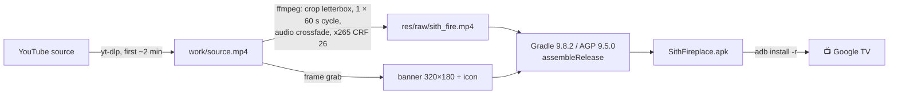

# 🔥 Sith Fireplace TV

**Turn your living-room TV into a crackling Sith yule log, built by AI from a single prompt.**

Sith Fireplace TV is a tiny, fully offline Android TV / Google TV app that plays a
seamless, full-screen fireplace loop forever. It needs no network, no ads and no account,
and it keeps the screen on until you press **Back** or **Home**.

The twist: the whole project, from downloading and encoding the video to the Java app,
Gradle build, signing and installing on a real TV, was built in one conversation with
**Claude Code** (Anthropic's AI coding agent). The exact prompts are included below.

> ⚠️ **This repository contains no video, images or APKs.** It contains only original
> source code and a build script. See [Copyright & trademarks](#%EF%B8%8F-copyright--trademarks).

---

## ✨ Highlights

| | |
|---|---|
| 📺 **Made for the big screen** | Leanback launcher banner, landscape, immersive full screen, D-pad friendly |
| ✈️ **100 % offline** | The video is bundled in the APK. The app requests **zero permissions**, not even Internet |
| ♾️ **Seamless loop** | One exact 60-second picture cycle with an equal-power audio crossfade, so there's no visible or audible seam |
| 🖼️ **Edge-to-edge** | Letterbox bars are cropped out so the fire fills the whole 16:9 screen |
| 🪶 **Tiny** | About **17 MB**, down from **191 MB** in the first build (see below) |
| 🌙 **Screensaver too** | Optional silent screensaver (Android `DreamService`), set over adb |
| 🔁 **Remembers its place** | Pauses in `onPause`, resumes where it left off in `onResume` |
| 🧰 **No dependencies** | Plain Java, `MediaPlayer` + `SurfaceView`, no third-party libraries |
| 🛠️ **One-command rebuild** | `./build.sh [TV_IP[:PORT]]` runs the whole pipeline and can install on your TV |

## 📉 From 191 MB to 17 MB: the "creative loop" trick

| Build | Video | APK size |
|---|---|---|
| v1: 5-minute clip, H.264 CRF 21 | 1920×1080, letterboxed | 151 MB |
| v2: cropped to fill the screen | same, upscaled crop | 191 MB |
| v3: **one 60 s seamless loop**, HEVC CRF 23 | H.265 Main@4.1 | 21.5 MB |
| v4: HEVC CRF 26 | H.265 Main@4.1 | **16.8 MB** |

While analysing the source, Claude found that the 8-hour video's picture is a
**single 60-second clip repeated** (period 1,800 frames at 30 fps, after a ~24 s intro).
Shipping one cycle looks identical to shipping eight hours. The soundtrack *doesn't*
repeat, so the audio loop is stitched with a 2-second equal-power crossfade.

Going from CRF 23 to CRF 26 changed SSIM against the source from 0.9785 to 0.9776.
That's a 22 % smaller video with no visible difference on moving fire.

## 🎬 Video source

The fireplace footage comes from this YouTube video, which `build.sh` downloads
**on your own machine at build time**:

**"Darth Vader Yule Log 8 Hours"**: <https://www.youtube.com/watch?v=CRbiqM6kif8>

Only the first ~2 minutes are fetched (`yt-dlp --download-sections`), and only one
60-second cycle ends up in the APK.

## 🚀 Build it yourself

Requirements: Linux/macOS, JDK 17+, Android SDK (`$ANDROID_HOME` or `~/Android/Sdk`),
`ffmpeg` with `libx265`, and `yt-dlp` (installed via `pipx` if missing).

```bash
git clone https://github.com/crash101g/sith-fireplace-tv.git
cd sith-fireplace-tv
./build.sh                       # build only → SithFireplace.apk
./build.sh 192.168.1.50          # build + install via adb (port 5555)
./build.sh 192.168.1.50:37123    # build + install via Wireless debugging port
```

On the TV, enable **Developer options → USB/Wireless debugging** and accept the
"Allow debugging" prompt the first time.

### 🌙 Use it as your screensaver

Besides the app, the APK includes an Android screensaver (`SithDreamService`) that plays
the same seamless loop, **with the sound off**, whenever the TV goes idle. Press any
button on the remote to wake the TV.

Google TV's **Settings** menu only offers Google's own Ambient Mode and hides third-party
screensavers, so you switch screensavers from a computer with `adb`. Nothing needs to be
rooted, and the app itself never changes any settings.

#### 1. Connect to the TV

On the TV, turn on **Developer options → Wireless debugging** (or USB debugging), then:

```bash
adb connect <TV-IP>:<PORT>      # e.g. 192.168.1.50:5555
adb devices                     # the TV should be listed as "device"
```

#### 2. Note your current screensaver

Save this so you can return to exactly what you had before:

```bash
adb shell settings get secure screensaver_components
```

On most Google TVs this prints Google's Ambient Mode component or `null`.

#### 3. Make Sith Fireplace the screensaver

```bash
adb shell settings put secure screensaver_enabled 1
adb shell settings put secure screensaver_components com.crash101g.sithfire/.SithDreamService
```

Or let the build script install the app and select the screensaver in one step:

```bash
SCREENSAVER=1 ./build.sh <TV-IP>:<PORT>
```

It starts after the TV's usual screensaver idle time.

#### 4. Go back to the Google TV default

- If step 2 printed a component name, put that value back:
  ```bash
  adb shell settings put secure screensaver_components <value-from-step-2>
  ```
- If it printed `null`, delete the setting and the TV falls back to Ambient Mode:
  ```bash
  adb shell settings delete secure screensaver_components
  ```
- Uninstalling the app (`adb uninstall com.crash101g.sithfire`) also sends the TV back
  to its default screensaver.

#### Notes

- A Google TV system update can reset the screensaver setting. If that happens, run
  step 3 again.
- The screensaver needs no permissions. The `BIND_DREAM_SERVICE` line in the manifest
  only lets the system start it.
- To hear the fire in the screensaver, set `PLAY_AUDIO = true` in
  `SithDreamService.java` and rebuild.

### Pipeline



### Tech specs

- Package `com.crash101g.sithfire`, minSdk 24, targetSdk 35, compileSdk 36
- Gradle 9.8.2 + Android Gradle Plugin 9.5.0, debug-signed release build
- `androidResources { noCompress 'mp4' }`, so the video is stored uncompressed and played straight from the APK
- `LEANBACK_LAUNCHER` + `LAUNCHER`; `leanback`, `touchscreen` and `screen.landscape` features all `required=false`
- `FLAG_KEEP_SCREEN_ON`, immersive mode, `MediaPlayer.setLooping(true)` on a `SurfaceView`
- Tested on an onn 4K Pro (Google TV), which uses the hardware HEVC decoder

## 🤖 Built with Claude Code: the prompts

These are the prompts used, in order, unedited apart from the TV's LAN address.
Everything else (debugging the toolchain, finding the 60-second loop, fixing an
ffmpeg audio bug, measuring quality) was done by Claude Code.

<details>
<summary><b>Prompt 1: the spec</b> (the project was originally called "Vader Fireplace")</summary>

```text
Build me a Google TV (Android TV) APK called "Vader Fireplace" that plays a local,
offline 1080p video full screen and loops it until I press Back or Home.

Source video: https://www.youtube.com/watch?v=CRbiqM6kif8

Steps:
1. Create the project in ~/Downloads/vader-fireplace-tv.
2. Download the video with yt-dlp at 1080p or lower (install it with pipx if it's missing).
3. Use ffmpeg to cut a 5-minute clip: 1920x1080, 30 fps, H.264 high profile level 4.1,
   CRF 21, preset veryfast, AAC 160k stereo, +faststart. If the source is shorter than
   5 minutes, loop it to fill 5 minutes. Save it as app/src/main/res/raw/vader_fire.mp4.
4. App requirements:
   - Plain Java, no third-party libraries. Use MediaPlayer on a SurfaceView with
     setLooping(true), playing the clip from res/raw. No network permission at all.
   - Full screen and immersive, FLAG_KEEP_SCREEN_ON, landscape only.
   - Manifest: LEANBACK_LAUNCHER and LAUNCHER categories, leanback and touchscreen
     features with required=false, a 320x180 banner made from a frame of the clip,
     and an app icon.
   - Stop playback in onPause and pick up where it left off in onResume.
   - In Gradle, set androidResources noCompress 'mp4' so the video isn't compressed in the APK.
   - Package com.crash101g.vaderfire, minSdk 24, targetSdk 35, the AGP version that
     matches my installed Gradle, signed with the debug key.
5. Use my SDK at ~/Android/Sdk (or $ANDROID_HOME), build it, and copy the result to
   ~/Downloads/vader-fireplace-tv/VaderFireplace.apk.
6. Fix any build errors until assembleRelease succeeds.
7. Ask me for my TV's IP, then install with adb connect <IP>:5555, adb install -r,
   and launch it.
8. Also write a build.sh that runs this whole pipeline again, and a .gitignore that
   keeps out the video, the work/ folder and build outputs.
```
</details>

**Follow-ups:**

2. `wireless debugging is enabled.  <TV-IP>:<PORT>`
3. `can you make it fill the entire screen`
4. `what is the size of the APK?`
5. `encode with HEVC/H.265.  Is there a way to use less space by using creative loops and morphing?`
6. `try CRF 26 to make it smaller`
7. `when finished tell how big is the APK now?  Can anyone tell the difference in video quality?`
8. `Do a marketing write up on this, be cautious of any potential movie copyright takedowns, refererence the youtube source, and the Claude AI prompts to make it.  Post to my github`
9. `rename it to Sith Fireplace TV`

## ⚖️ Copyright & trademarks

- **Fan project, not affiliated with or endorsed by Lucasfilm Ltd., The Walt Disney
  Company, Google, or the YouTube uploader.** *Star Wars*, *Darth Vader* and *Sith* are
  trademarks of Lucasfilm Ltd. They're used here only to describe the content.
- **No copyrighted media is in this repository.** No video, audio, frames, banner,
  icon or APK is committed or released. `.gitignore` excludes all of them.
  They exist only on the machine of whoever runs `build.sh`.
- The footage belongs to its respective rights holders. Before running the build,
  make sure you have the right to download and use it, and follow
  [YouTube's Terms of Service](https://www.youtube.com/t/terms) and your local laws.
  Builds are for **personal, private use only**. Please don't redistribute the
  resulting APK or video.
- Rights holders: if you have a concern, please
  [open an issue](https://github.com/crash101g/sith-fireplace-tv/issues) and it will be
  addressed promptly.
- You can swap in **any fireplace video you have rights to** by changing `URL`
  (and, if needed, `LOOP_START` / `LOOP_LEN` / `CROP`) at the top of `build.sh`.

## 📄 License

The original source code and build scripts are released under the [MIT License](LICENSE).
The license covers the code only, not any third-party video, audio or imagery.
